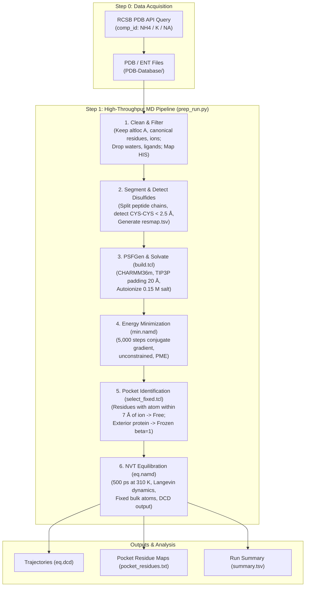

# High-Throughput NAMD Pipeline for Ion-Binding Pockets

[](https://www.python.org/)
[](https://www.ks.uiuc.edu/Research/namd/)
[](https://www.ks.uiuc.edu/Research/vmd/)
[](http://mackerell.umaryland.edu/charmm_ff.shtml)
[](LICENSE)

An automated, scalable pipeline for downloading, preparing, and simulating protein ion-binding pockets in high throughput. This pipeline systematically builds all-atom simulation systems with **CHARMM36m**, solvates and ionizes them with **VMD / psfgen**, performs unconstrained energy minimization with **NAMD**, defines local binding pockets within a configurable spherical radius around target ions, freezes distant structural bulk, and carries out restrained **NVT equilibration** to sample ion-pocket dynamics at scale.

---

## Table of Contents

- [Overview](#overview)
- [Workflow Architecture](#workflow-architecture)
- [Repository Structure](#repository-structure)
- [Prerequisites & Dependencies](#prerequisites--dependencies)
- [Quick Start](#quick-start)
- [Step 0: PDB Acquisition](#step-0-pdb-acquisition)
- [Step 1: Simulation Pipeline](#step-1-simulation-pipeline)
  - [Pipeline Stages](#pipeline-stages)
  - [CLI Reference](#cli-reference)
  - [Directory Outputs](#directory-outputs)
- [Pocket Selection & Restraint Logic](#pocket-selection--restraint-logic)
- [Parallel Execution & Performance](#parallel-execution--performance)
- [License](#license)

---

## Overview

Investigating ion-protein coordination (e.g., Ammonium $\text{NH}_4^+$, Potassium $\text{K}^+$, Sodium $\text{Na}^+$) across large structural datasets often suffers from manual preparation bottlenecks, non-standard residue clashes, and excessive computational overhead when simulating full bulky systems.

This toolkit provides:
- **Targeted PDB Mining**: Automated querying of RCSB PDB Search API v2 for protein-only entries bearing non-covalently coordinated ions.
- **Robust Cleaning & Disulfide Detection**: Automated extraction of primary models, resolution of alternate conformations, removal of crystal waters and irrelevant ligands, auto-detection of disulfide bridges ($< 2.5\text{ \AA}$), and standard histidine mapping (`HSD`/`HSE`/`HSP`).
- **Standardized Topology Generation**: Uses VMD `psfgen` with CHARMM36m to reconstruct missing heavy atoms and hydrogens, build periodic boundaries, solvate with TIP3P water, and neutralize/ionize to physiological salt concentrations.
~- **Localized Pocket Dynamics**: Minimizes the entire system, dynamically identifies all protein residues within a cutoff (default: $7.0\text{ \AA}$) of any bound ion, freezes bulk exterior protein residues (`beta=1`), and leaves the pocket, ions, and solvent fully flexible (`beta=0`) during 500 ps NVT equilibration.~

---

## Workflow Architecture



---

## Repository Structure

```text
.
├── LICENSE
├── README.md
├── PDB-Database/                               # Downloaded structures organized by ion
│   ├── nh4_protein_only/                       # Ammonium-bound PDBs
│   ├── pot_protein_only/                       # Potassium-bound PDBs
│   └── sod_protein_only/                       # Sodium-bound PDBs
├── step-0-download-scripts/                     # RCSB Search API acquisition scripts
│   ├── download-nh4.py                         # Fetches NH4+-bound proteins
│   ├── download-pot.py                         # Fetches K+-bound proteins
│   └── download-sod.py                         # Fetches Na+-bound proteins
└── step-1-run-highthroughput-namd/              # Execution pipeline and simulation templates
    ├── prep_run.py                             # Main parallel orchestration script
    ├── build.tcl                               # VMD/psfgen script: PSF build, solvate, ionize
    ├── select_fixed.tcl                        # VMD script: Pocket selection and beta labeling
    ├── common.namd                             # Shared NAMD parameters & force field inputs
    ├── min.namd                                # 5,000-step unconstrained minimization
    ├── eq.namd                                 # 500 ps pocket-restrained NVT equilibration
    ├── toppar/                                 # CHARMM36m topologies (RTF) & parameters
    └── inputs-toppar/                          # Extended CHARMM force field parameter set
```

---

## Prerequisites & Dependencies

### 1. System Requirements
- **Linux** (x86_64)
- **Python 3.8+**
- **VMD** (`vmd` in `PATH`, text-mode capable)
- **NAMD** (`namd3` or `namd2` in `PATH`)

### 2. Python Packages
Install the required Python libraries:
```bash
pip install requests biopython
```

### 3. Verify VMD & NAMD Installation
Check that VMD and NAMD binaries are available in your shell:
```bash
vmd -dispdev text -e /dev/null
namd3 +p1 --version || namd2 --version
```

---

## Quick Start

### 1. Download PDB Datasets (Step 0)
Run any of the acquisition scripts to fetch protein structures containing non-covalently bound ions:
```bash
cd step-0-download-scripts
python download-nh4.py
cd ..
```
Structures will be saved into `PDB-Database/nh4_protein_only/`.

### 2. Dry Run / Prepare Systems (Inspect Topology & Solvation)
Use `--prep-only` to clean, build topologies, and solvate without launching NAMD simulations:
```bash
cd step-1-run-highthroughput-namd
python prep_run.py \
    --input-dir ../PDB-Database/nh4_protein_only \
    --out-dir ../step-1-out/runs-nh4 \
    --ff-dir ./toppar \
    --jobs 4 \
    --cores 4 \
    --prep-only
```

### 3. Run the Full Simulation Pipeline
Omit `--prep-only` to execute the full pipeline (Minimization $\to$ Pocket Selection $\to$ Equilibration):
```bash
python prep_run.py \
    --input-dir ../PDB-Database/nh4_protein_only \
    --out-dir ../step-1-out/runs-nh4 \
    --ff-dir ./toppar \
    --jobs 4 \
    --cores 4
```

---

## Step 0: PDB Acquisition

The download scripts in `step-0-download-scripts/` interface directly with the **RCSB PDB Search API v2**:
- **Targeted Filtering**:
  - `entity_poly.rcsb_entity_polymer_type == "Protein"` (restricts entries to protein-only polymers)
  - `rcsb_nonpolymer_instance_annotation.comp_id` matches the ion (`NH4`, `K`, or `NA`)
  - `rcsb_nonpolymer_instance_annotation.type == "HAS_NO_COVALENT_LINKAGE"`
- **Pagination & Batch Download**: Uses RCSB pagination to retrieve all matching entries, and downloads full PDB coordinate files using Biopython's `Bio.PDB.PDBList`.

| Script | Target Ion | Chemical ID | Default Output Directory |
|:---|:---|:---|:---|
| `download-nh4.py` | Ammonium ($\text{NH}_4^+$) | `NH4` | `../PDB-Database/nh4_protein_only` |
| `download-pot.py` | Potassium ($\text{K}^+$) | `K` | `../PDB-Database/pot_protein_only` |
| `download-sod.py` | Sodium ($\text{Na}^+$) | `NA` | `../PDB-Database/sod_protein_only` |

---

## Step 1: Simulation Pipeline

### Pipeline Stages

1. **PDB Cleaning & Sanitization (`clean()` in `prep_run.py`)**:
   - Parses coordinate records (`ATOM` and `HETATM`).
   - Keeps only the first model in NMR ensembles (`ENDMDL`).
   - Resolves alternate conformations by selecting conformation `A` (or the first alphabetical alternative).
   - Removes crystal waters, crystallization additives, buffer molecules, and non-target heteroatoms.
   - Retains canonical amino acids (`CANON`) and recognizes standard histidine variants (`HSD`, `HSE`, `HSP`).
   - Retains bound target ions (`NA`, `K`, `NH4`).
   - Strips original hydrogens (re-built deterministically by `psfgen`).
   - Discards structures containing non-canonical residues or backbone modifications.

2. **Segmentation & Disulfide Mapping**:
   - Splits protein chains into contiguous segments (`P001`, `P002`, ...) if chain ID changes or peptide bond distance $d(\text{C}_{i}, \text{N}_{i+1}) > 2.0\text{ \AA}$.
   - Detects cysteine pairs with $\text{S}_\gamma - \text{S}_\gamma$ distance $< 2.5\text{ \AA}$ and writes `disu.txt` for automated patching via `patch DISU`.
   - Generates `resmap.tsv` preserving the mapping between segmented indices and original PDB chain/residue numbers.
   - Assigns unique segments to target ions (`I001`, `I002`, ...).

3. **Topology Generation, Solvation & Autoionization (`build.tcl`)**:
   - Executes VMD in headless text mode (`-dispdev text`).
   - Sources CHARMM36m topologies (`top_all36_prot.rtf`, `toppar_water_ions.str`, etc.).
   - Guesses coordinates for missing atoms and hydrogens (`guesscoord`).
   - Solvates the complex with a TIP3P water box using a minimum padding distance (default: $20.0\text{ \AA}$).
   - Computes periodic simulation cell basis vectors and origin, writing `cell.tcl`.
   - Neutralizes system charge and sets background ionic strength (default: 0.15 M) matching the target cation.

4. **Energy Minimization (`min.namd`)**:
   - Runs 5,000 steps of conjugate gradient minimization with all atoms unconstrained.
   - Uses Particle Mesh Ewald (PME) electrostatics with a 1.0 Å grid spacing.
   - Standard CHARMM force switching from 10.0 Å to 12.0 Å, with pairlist distance at 14.0 Å.

5. **Pocket Definition & Restraints (`select_fixed.tcl`)**:
   - Loads the minimized coordinates (`min.coor`).
   - Identifies all protein residues with at least one atom within the pocket cutoff distance (default: $7.0\text{ \AA}$) of any bound ion (`segname =~ "I0.*"`).
   - Writes `pocket_residues.txt` documenting the mobile binding site residues.
   - Generates `fixed.pdb` setting the B-column (`beta`):
     - `beta = 0`: Pocket residues, water molecules, and ions (mobile).
     - `beta = 1`: Bulk protein residues outside the pocket (frozen).

6. **NVT Equilibration (`eq.namd`)**:
   - 500 ps MD simulation at 310 K with 2.0 fs timestep and SHAKE/RATTLE (`rigidBonds all`).
   - Langevin dynamics temperature control with damping coefficient $\gamma = 1.0\text{ ps}^{-1}$.
   - Restrains bulk atoms via `fixedAtoms on` reading `fixed.pdb`.
   - Writes DCD trajectory frames every 1 ps (100–500 frames) and updates restart files.

---

### CLI Reference

`prep_run.py` accepts the following arguments:

```bash
python prep_run.py [OPTIONS]
```

| Flag | Type | Default | Description |
|:---|:---|:---|:---|
| `--input-dir` | Path | *Required* | Directory containing input `.pdb` or `.ent` files |
| `--out-dir` | Path | *Required* | Target directory where individual run folders will be generated |
| `--ff-dir` | Path | *Required* | Path containing CHARMM36m RTF files (`top_all36_prot.rtf`, `toppar_water_ions.str`) |
| `--extra-top` | String | `""` | Colon-separated list of additional topology files (e.g. custom ligand/ion RTF) |
| `--extra-par` | String | `""` | Colon-separated list of additional parameter files (e.g. custom ligand PRM) |
| `--padding` | Float | `20.0` | Minimum water padding around solute in Angstroms |
| `--salt-conc` | Float | `0.15` | Salt concentration in M (0 = neutralize only) |
| `--pocket-cutoff` | Float | `7.0` | Cutoff radius in Angstroms around ions defining mobile pocket residues |
| `--jobs` | Int | `1` | Number of protein structures to process concurrently |
| `--cores` | Int | `4` | Number of CPU cores allocated to each NAMD instance |
| `--vmd` | String | `"vmd"` | Command to invoke VMD |
| `--namd` | String | `"namd3"` | Command to invoke NAMD (e.g. `"namd3"`, `"namd2"`, or `"charmrun ++local namd2"`) |
| `--prep-only` | Flag | `False` | Stop after cleaning, PSF generation, and solvation |
| `--force` | Flag | `False` | Overwrite and re-run structures that have completed trajectories (`eq.dcd`) |

---

### Directory Outputs

For each processed entry (e.g. `pdb1cpd`), a self-contained directory is created under `--out-dir`:

```text
runs-nh4/pdb1cpd/
├── P001.pdb, P002.pdb ...      # Extracted individual protein segments
├── I001.pdb ...                # Extracted bound ion segments
├── segments.txt                # Segment manifest used by psfgen
├── salt.txt                    # Identified cation and atom name for ionization
├── disu.txt                    # Detected disulfide bridges (if present)
├── resmap.tsv                  # Segid + new_resid <-> original PDB chain + resid mapping
├── prot_ions.pdb / .psf        # Gas-phase reconstructed complex with hydrogens
├── solvated.pdb / .psf         # System after water box addition
├── autoion.pdb / .psf          # Intermediate ionized coordinates
├── ionized.pdb / .psf          # Final neutralized, solvated system
├── cell.tcl                    # Periodic box vectors and center for NAMD
├── charge.txt                  # Final net charge verification
├── build.log                   # VMD psfgen build log
├── min.namd / min.log          # Minimization configuration and log
├── min.coor / .vel / .xsc      # Minimized binary coordinates, velocities, and cell
├── select_fixed.tcl            # Pocket selection script
├── select.log                  # Pocket selection output
├── fixed.pdb                   # Restraint reference PDB (B-factor=1 for frozen atoms)
├── pocket_residues.txt         # List of mobile binding site residues
├── eq.namd / eq.log            # Equilibration configuration and log
├── eq.dcd                      # Binary trajectory file (pocket dynamics)
└── eq.restart.*                # Final checkpoint restart files (coor, vel, xsc)
```

In addition, `--out-dir/summary.tsv` logs the status of every structure:
```text
entry       status    note
pdb1cpd     ok        1 segs, 289 res, 1 ions
pdb1d7h     skipped   non-standard residue MSE A105 in ATOM records
pdb1d7i     ok        1 segs, 312 res, 2 ions
```

---

## Pocket Selection & Restraint Logic

Rather than simulating full unconstrained protein fluctuations—which requires lengthy simulations to reach equilibrium—this pipeline implements a **sphere-of-interest restraint protocol**:

1. **Minimization**: Relieves local clashes across the entire system.
2. **Pocket Query**: In VMD:
   ```tcl
   set pocket [atomselect top "same residue as (protein and within 7.0 of (segname =~ \"I0.*\"))"]
   ```
   Whole residues are selected so peptide backbone connectivity and local secondary structure remain intact.
3. **Fixed Atoms**:
   - `beta = 0`: Mobile atoms (all atoms of pocket residues + all water + all ions).
   - `beta = 1`: Frozen atoms (all atoms of non-pocket protein residues).
4. **NAMD Enforcement**:
   ```namd
   fixedAtoms     on
   fixedAtomsFile fixed.pdb
   fixedAtomsCol  B
   ```
   This keeps the bulk architecture rigidly stable while permitting the pocket residues, coordination spheres, water networks, and ions to explore conformational space.

---

## Parallel Execution & Performance

`prep_run.py` utilizes Python's `ProcessPoolExecutor` to parallelize over structures while using multithreading inside NAMD:

$$\text{Total CPU Cores Utilized} = \text{jobs} \times \text{cores}$$

### Recommended Sizing Examples:
- **Workstation (16 Cores)**:
  `--jobs 4 --cores 4`
- **Compute Node (64 Cores)**:
  `--jobs 16 --cores 4` or `--jobs 8 --cores 8`
- **Single GPU Workstation with NAMD3 CUDA**:
  Pass `--namd "namd3 +idlepoll +devices 0"` with `--jobs 1 --cores 4` or batch sequentially.

Entries that complete successfully produce `eq.dcd`. Re-running `prep_run.py` automatically detects existing `eq.dcd` files and resumes unfinished work without duplicating completed simulations (use `--force` to override).

---

## License

This project is licensed under the [MIT License](LICENSE).
